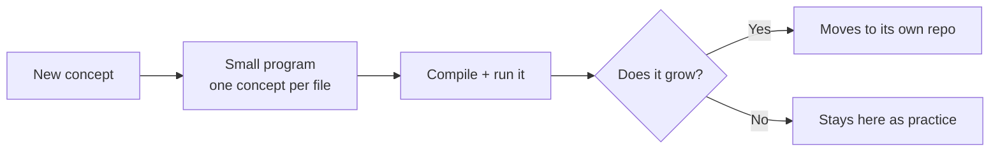

# Practice Files


[](https://skillicons.dev)

My scratchpad. When I learn a new concept I write a small program for it here first, one concept per file, nothing complicated. If something grows into a real project it moves to its own repo — this one stays as the practice ground.

## How I practise



## What's in here

### PasswordChecker.cpp (C++)

Checks if a password is strong enough or not. The rules are simple:

- At least 8 characters
- At least one uppercase letter
- At least one lowercase letter
- At least one digit

It tells you the first rule your password fails, or says it's valid.

**Run it:**

```bash
g++ PasswordChecker.cpp -o password_checker
./password_checker
```

More files will land here as I practise.

— **Pawan Kumar** · [@pawanriko](https://github.com/pawanriko)
